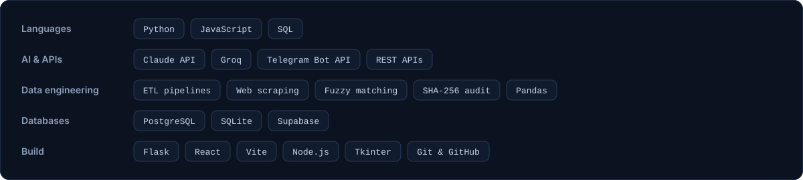

```markdown
<div align="center">
  

  [Email](mailto:JhonsonAyalew21@gmail.com) &nbsp;|&nbsp; [Portfolio](https://jhonson-ayalew.vercel.app) &nbsp;|&nbsp; [LinkedIn](https://linkedin.com/in/johnson-ayalew)
</div>

<br/>

I build AI-powered automation systems that eliminate repetitive work. My focus is Python, web scraping, ETL pipelines, data processing, and LLM integrations using Claude API and Groq. I also develop full-stack applications using React and Flask, turning complex workflows into practical software solutions.


## Tech Stack



## Experience

**AI Automation Engineer & Python Developer**  
Freelance &nbsp;·&nbsp; 2023 – Present

- Develop Python-based automation tools and data pipelines.
- Build web scrapers, ETL workflows, and data processing systems.
- Integrate LLM APIs to automate research, information extraction, and content generation.
- Develop backend services and dashboards for automation workflows.

**Full-Stack Developer**  
ConcreteRent &nbsp;·&nbsp; 2024

- Developed a full-stack rental platform.
- Built the frontend with React and backend services with Flask.
- Implemented REST APIs and booking functionality.

## Education

**BSc in Computer Science**  
Ambo University &nbsp;·&nbsp; 2021 – 2024

---

<div align="center">
  <b>Open to remote opportunities, full-time roles, and contract work.</b>
  <br/>
  <sub>Interested in AI automation, Python development, ETL, and backend engineering.</sub>
</div>
```
